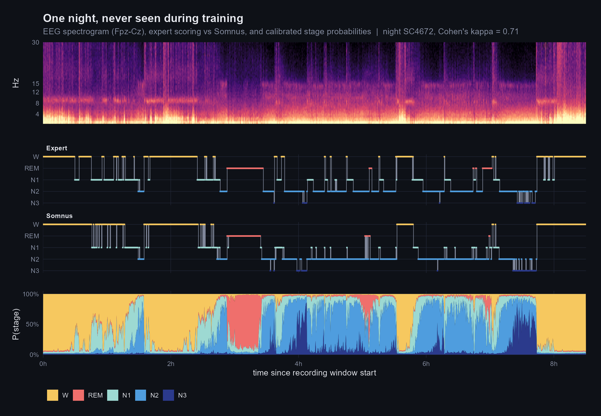
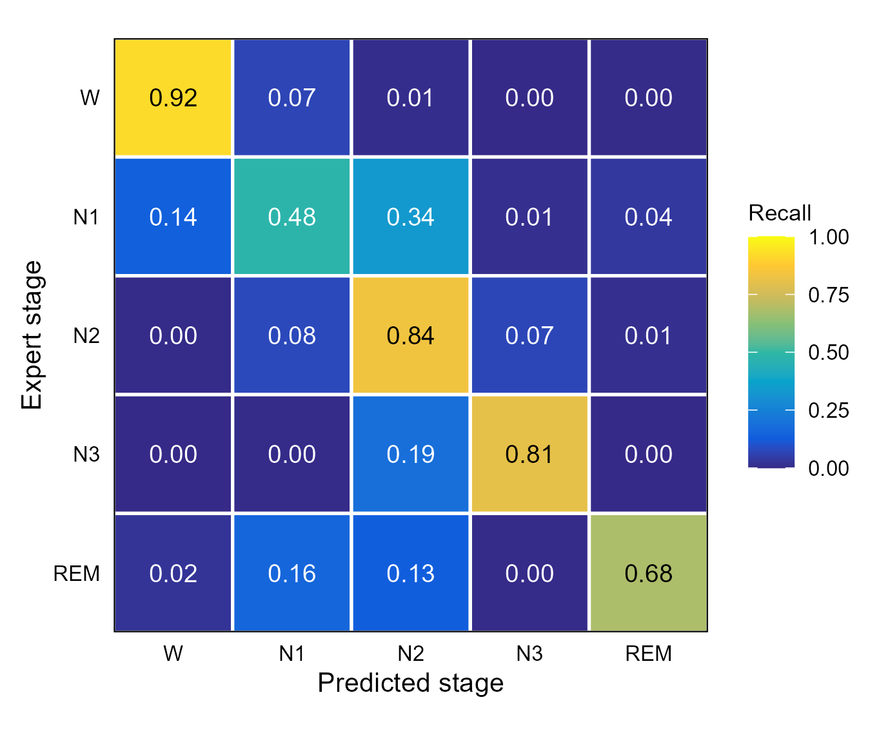
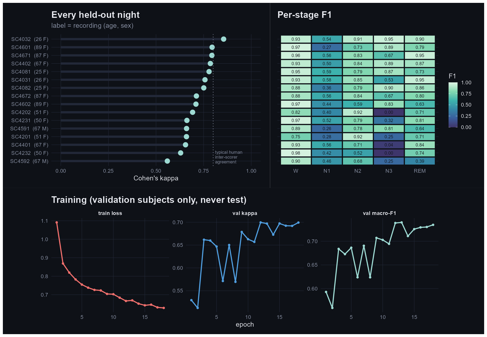
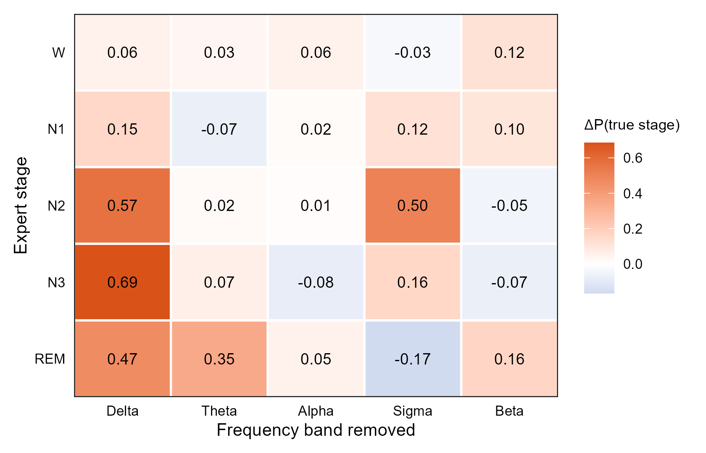
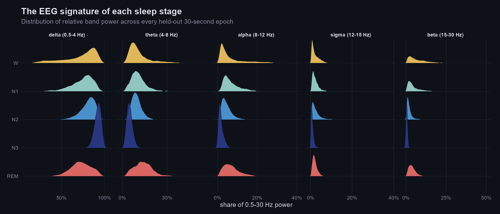
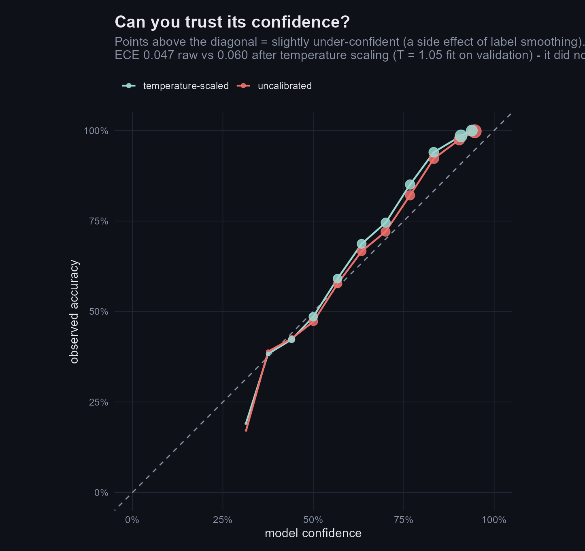

# Somnus

**Automatic sleep staging from a single EEG channel, with a CNN + transformer trained on PhysioNet's Sleep-EDF and tested on people it has never seen, aged 25 to 89.**



A sleep study is scored by hand: a technician reads a full night of EEG in 30-second pages and labels each one Wake, N1, N2, N3 (deep sleep) or REM. One night takes 1–2 hours to score. Somnus does it in seconds from one forehead electrode (Fpz-Cz), and reports how far its output can be trusted.

## Results on held-out people

The test set is **8 people (16 nights, 20,315 epochs)** chosen before training, stratified by age, and never used for training, early stopping or calibration.

| metric | Somnus (test) |
|---|---|
| Accuracy | **80.0%** |
| Macro-F1 | **0.750** |
| Cohen's κ | **0.730** |
| F1 by stage: W / N1 / N2 / N3 / REM | 0.93 / 0.46 / 0.80 / 0.78 / 0.79 |

For context, two human experts scoring the same night typically agree at roughly κ ≈ 0.76–0.80. N1 is also the stage humans agree on least.

<p align="center"></p>

### Performance by age

The training data covers the whole adult lifespan (25–101). Most published results on Sleep-EDF use only the first 20 subjects, who are almost all under 35.

| age group | test nights | mean κ | mean N3 F1 |
|---|---|---|---|
| 25–39 | 4 | 0.785 | 0.81 |
| 40–64 | 4 | 0.661 | 0.14 |
| 65–79 | 4 | 0.665 | 0.50 |
| 80+ | 4 | 0.752 | 0.77 |

Middle-aged and older nights are harder, and almost all of the gap comes from deep sleep. Slow-wave sleep shrinks with age, so some of these nights have only a few minutes of N3, and a handful of mistakes moves the F1 a lot. With 2 test nights per person and only one male test subject, these are **descriptive numbers, not a fairness claim**. A proper subgroup audit needs the full 78-subject cohort and cross-validation (see *Next steps*).



## What the network actually uses

To check that the model relies on real physiology and not on recording artefacts, each EEG frequency band was filtered out of the test nights in turn, and the drop in the probability of the correct stage was measured.



The attributions match textbook sleep physiology without being told it. Deep sleep (N3) collapses without **delta slow waves** (−0.69). N2 needs **sigma, the band of sleep spindles** (−0.50). REM leans on **theta** (−0.35). The distributions behind this:



## Can you trust the confidence?

<p align="center"></p>

Out of the box, the model is **well calibrated and slightly under-confident** (ECE 0.047): when it says 80%, it is right a bit more often than that. Temperature scaling fitted on the validation subjects (T = 1.05) made test calibration slightly *worse* (ECE 0.060), so it did not transfer across people. It is reported here instead of being dropped quietly. The likely cause is label smoothing during training. Per-subject calibration is a better direction.

## How it works

```
EDF file ─► band-pass 0.3–35 Hz ─► robust per-night scaling ─► 30 s epochs (3000 samples)
                                                                   │
            ┌──────────────────────────────────────────────────────┘
            ▼
   Epoch encoder (1-D CNN, ~0.5 s first-layer receptive field)  ─►  128-d vector per epoch
            ▼
   Transformer encoder over 21 consecutive epochs (10.5 min of context)
            ▼
   Per-epoch stage logits, averaged over overlapping windows across the whole night
```

- **No leakage across people.** Splits are made by subject, never by epoch, and both nights of a person stay in the same split. A random epoch split inflates accuracy because neighbouring epochs are almost identical.
- **Age-stratified splits.** Subjects are shuffled within age bands and interleaved, so the validation and test sets cover the full age range.
- **Class imbalance.** N1 is about 10% of epochs. Training uses square-root inverse-frequency class weights and label smoothing, and unscored or movement epochs are masked out of the loss.
- **Augmentation.** Amplitude scaling, Gaussian noise, polarity flips, and random window shifts so each epoch sees the night from a new alignment.
- **Model selection** uses validation Cohen's κ (not accuracy) with early stopping. The best checkpoint came at epoch 12 of 18. Training took about 35 minutes on a 14-core laptop CPU, with no GPU.

523k parameters · PyTorch · MNE-Python · scikit-learn · figures in R (ggplot2, patchwork, ggridges, viridis).

## Reproduce

```bash
pip install torch --index-url https://download.pytorch.org/whl/cpu
pip install -e ".[dev]"

python scripts/download.py --subjects 0-23     # parallel, checksum-verified PhysioNet download
python scripts/download.py --subjects 39-48
python scripts/download.py --subjects 58-67
somnus prepare                                 # 85 nights -> 104,872 labelled epochs
somnus train                                   # writes runs/transformer-fpzcz/best.pt
somnus evaluate                                # metrics + tidy CSVs in runs/.../eval/
Rscript r/figures.R                            # every figure in this README
```

Stage a new night with the included checkpoint:

```bash
somnus predict path/to/SC4001E0-PSG.edf --out hypnogram.csv
```

`pytest` covers label parsing, sleep-window trimming, windowing, the subject-disjoint stratified split, model shapes, band-stop filtering and temperature scaling. CI runs `ruff` and the tests on every push.

```
src/somnus/   data.py  dataset.py  model.py  train.py  evaluate.py  metrics.py  cli.py
r/figures.R   ggplot2 figures from the exported CSVs
configs/      experiment config (YAML)
runs/         checkpoint, split, history, evaluation CSVs
```

## Limitations and next steps

- **Single split.** Eight test subjects is small. Next: leave-subjects-out cross-validation over all 78 Sleep-EDF subjects, with confidence intervals on κ.
- **One channel, one dataset.** External validation on a different cohort (for example SHHS or MASS) is the real test of whether it generalises.
- **Calibration.** Try per-recording temperature, or drop label smoothing and recalibrate.
- **Not a medical device.** This is a research and portfolio project. It has not been clinically validated.

## Data

Sleep-EDF Expanded, Sleep Cassette study: B. Kemp et al., *IEEE Trans. Biomed. Eng.* 47(9), 2000. Distributed by [PhysioNet](https://physionet.org/content/sleep-edfx/1.0.0/) (Goldberger et al., *Circulation* 2000) under the Open Data Commons Attribution License v1.0. No data is stored in this repository; it is downloaded from PhysioNet.

## License

Code: MIT.
